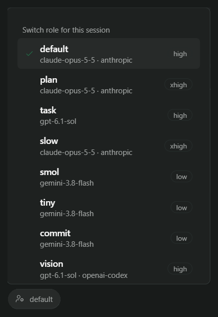
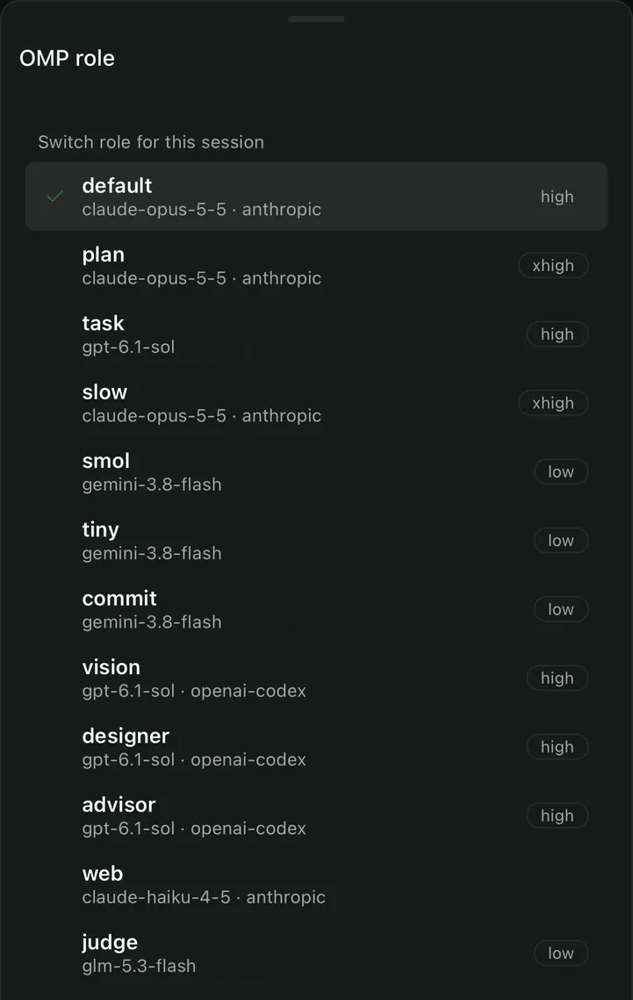

# OMP Roles

A Paseo plugin that adds an omp role picker to the composer of each OMP (Oh My Pi) agent. See [OVERVIEW.md](OVERVIEW.md).




## Install

```sh
paseo plugin add git:po-trottier/paseo-omp-roles
```

For development, install from a local clone with `paseo plugin add <dir>`, then run `paseo plugin reload paseo-omp-roles` after each change.

## Checks

```sh
npm ci
npm run typecheck
npm test
```
